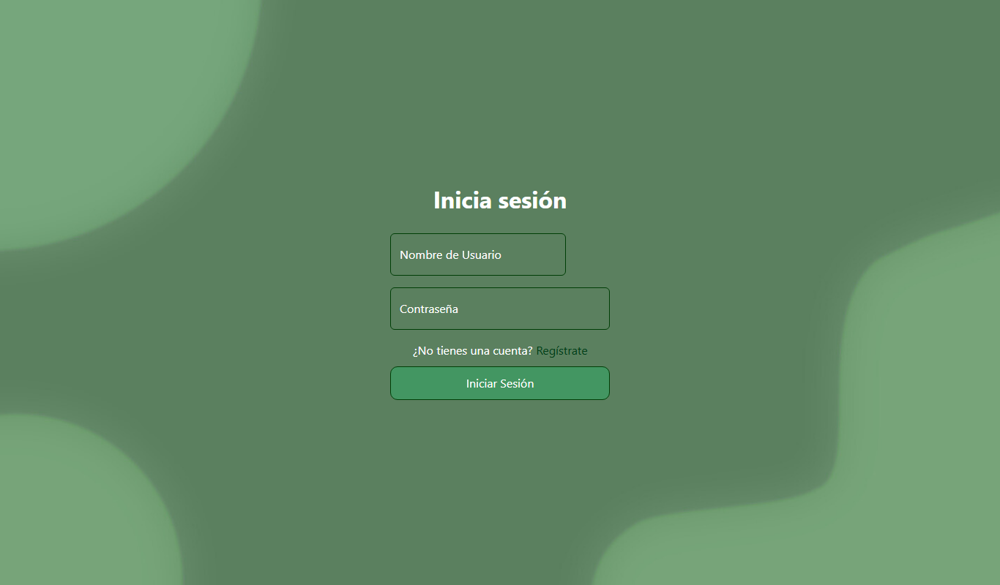
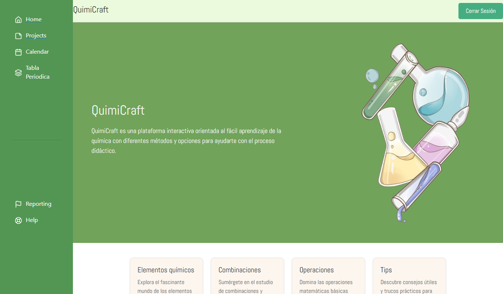
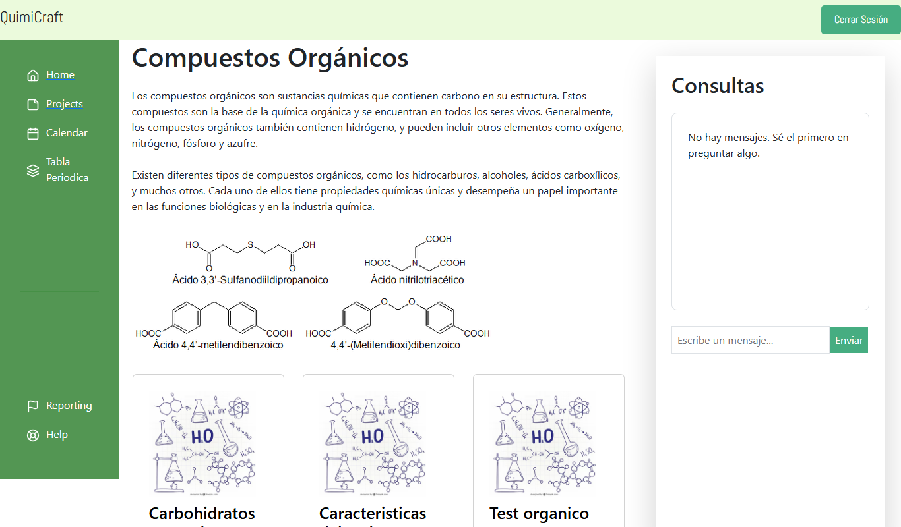
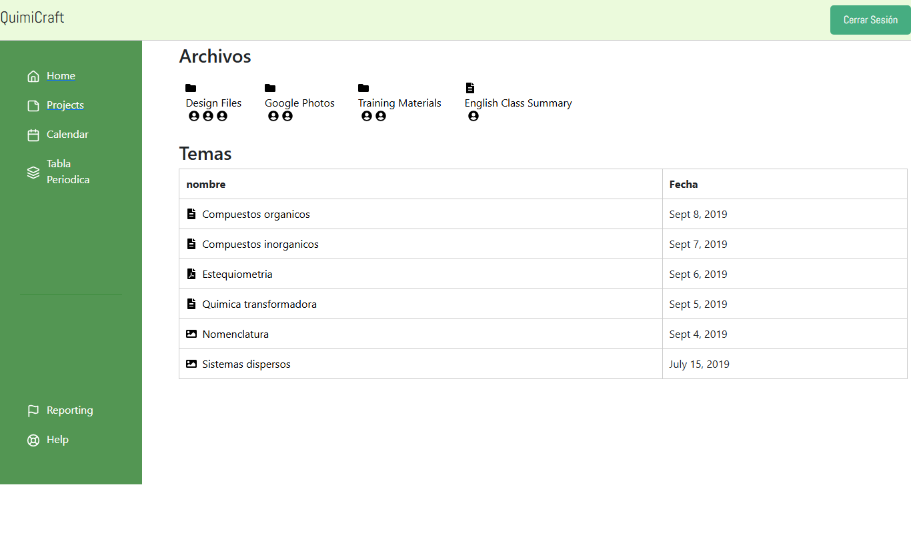

# ⚗️ QuimiCraft

**Aula virtual para estudiantes y profesores de Química Industrial.**

QuimiCraft es una plataforma web interactiva, al estilo de Google Classroom, pensada para que el aprendizaje de la química sea más simple. Reúne en un solo lugar los temas de la materia, el material de estudio y un espacio de consultas, con vistas distintas según el rol de cada usuario.

Proyecto desarrollado para el **Instituto Politécnico Formosa**.


---

## 📸 Capturas

| Inicio de sesión | Panel del estudiante |
|:---:|:---:|
|  |  |
| **Compuestos orgánicos y consultas** | **Archivos y temas** |
|  |  |

---

## ✨ Funcionalidades

- **Registro e inicio de sesión** con contraseñas encriptadas (bcrypt) y autenticación por token (JWT).
- **Tres roles de usuario:** estudiante, profesor y administrador. Cada uno entra a su propio panel después del login.
- **Rutas protegidas:** las vistas privadas solo se pueden abrir con una sesión iniciada.
- **Panel del estudiante** con menú lateral y categorías: elementos químicos, combinaciones, operaciones y tips.
- **Sección de compuestos orgánicos** con teoría, ejemplos de estructuras y un **chat de consultas**.
- **Archivos y temas:** listado del material de la materia (compuestos orgánicos e inorgánicos, estequiometría, nomenclatura, sistemas dispersos y más).
- **API REST de tareas** (crear, listar, editar y eliminar) asociadas a cada usuario.

---

## 🛠️ Tecnologías

| Frontend | Backend |
|---|---|
| React 18 + Vite | Node.js + Express |
| React Router (rutas públicas y privadas) | MySQL (`mysql2`) |
| Context API + `useReducer` para la sesión | JSON Web Token (`jsonwebtoken`) |
| React Bootstrap / Bootstrap 5 | bcrypt |
| Lucide React · React Icons | CORS · Morgan |

---

## 📁 Estructura

```
Quimicraft/
├── backend/
│   └── src/
│       ├── controllers/   # Lógica de autenticación y tareas
│       ├── db/            # Conexión a MySQL
│       ├── helpers/       # Generación y validación de JWT
│       ├── routes/        # Endpoints de la API
│       └── index.js       # Servidor Express (puerto 3000)
└── frontend/
    └── src/
        ├── context/       # Estado global del usuario (Context + reducer)
        ├── routes/        # AppRouter, rutas públicas y privadas
        └── views/
            ├── login/
            ├── register/
            ├── estudiantes/
            ├── profesores/
            └── admin/
```

---

## 🚀 Instalación

### Requisitos

- [Node.js](https://nodejs.org/) 18 o superior
- MySQL (por ejemplo con XAMPP o MySQL Workbench)

### 1. Clonar el repositorio

```bash
git clone https://github.com/AyelenAlva/Quimicraft.git
cd Quimicraft
```

### 2. Crear la base de datos

La API se conecta por defecto a una base llamada `quimicraf` en `localhost`, con el usuario `root` y sin contraseña. Estos datos se pueden cambiar en `backend/src/db/database.js`.

Script de referencia con las tablas que usa la API:

```sql
CREATE DATABASE quimicraf;
USE quimicraf;

CREATE TABLE tipousuario (
  idTipoUsuario INT AUTO_INCREMENT PRIMARY KEY,
  descripcion   VARCHAR(50) NOT NULL
);

INSERT INTO tipousuario (descripcion) VALUES ('admin'), ('estudiante'), ('profesor');

CREATE TABLE usuarios (
  id                   INT AUTO_INCREMENT PRIMARY KEY,
  nombre               VARCHAR(100),
  apellido             VARCHAR(100),
  usuario              VARCHAR(50) UNIQUE NOT NULL,
  correo               VARCHAR(100),
  contrasenia          VARCHAR(255) NOT NULL,
  id_rela_tipo_usuario INT,
  FOREIGN KEY (id_rela_tipo_usuario) REFERENCES tipousuario(idTipoUsuario)
);

CREATE TABLE tareas (
  idTarea         INT AUTO_INCREMENT PRIMARY KEY,
  nombre          VARCHAR(100),
  descripcion     TEXT,
  rela_id_usuario INT,
  FOREIGN KEY (rela_id_usuario) REFERENCES usuarios(id)
);
```

### 3. Levantar el backend

```bash
cd backend
npm install
npm run dev
```

La API queda disponible en `http://localhost:3000`.

### 4. Levantar el frontend

En otra terminal:

```bash
cd frontend
npm install
npm run dev
```

Abrí `http://localhost:5173` en el navegador.

---

## 🔌 Endpoints de la API

| Método | Ruta | Descripción | Requiere token |
|---|---|---|:---:|
| `POST` | `/register` | Registra un usuario nuevo | — |
| `POST` | `/login` | Inicia sesión y devuelve el token y el rol | — |
| `GET` | `/tipos-usuario` | Lista los tipos de usuario | — |
| `GET` | `/tareas` | Lista las tareas del usuario | ✅ |
| `GET` | `/tareas/:id` | Obtiene una tarea | — |
| `POST` | `/tareas` | Crea una tarea | ✅ |
| `PUT` | `/tareas/:id` | Actualiza una tarea | ✅ |
| `DELETE` | `/tareas/:id` | Elimina una tarea | ✅ |

El token se envía en el encabezado `token` de cada petición.

---

## 🗺️ Próximos pasos

- Completar los paneles de **profesores** y **administradores** con la carga de temas y material.
- Conectar el chat de consultas con la base de datos.
- Agregar la **tabla periódica** interactiva y el **calendario** de entregas.
- Pasar la configuración de la base de datos y la clave del JWT a variables de entorno (`.env`).

---

## 👩‍💻 Autora

**Cristal Ayelén Alva** · Desarrolladora Full Stack

[LinkedIn](https://www.linkedin.com/in/cristal-ayelen-alva-91a010238) · [GitHub](https://github.com/AyelenAlva)
